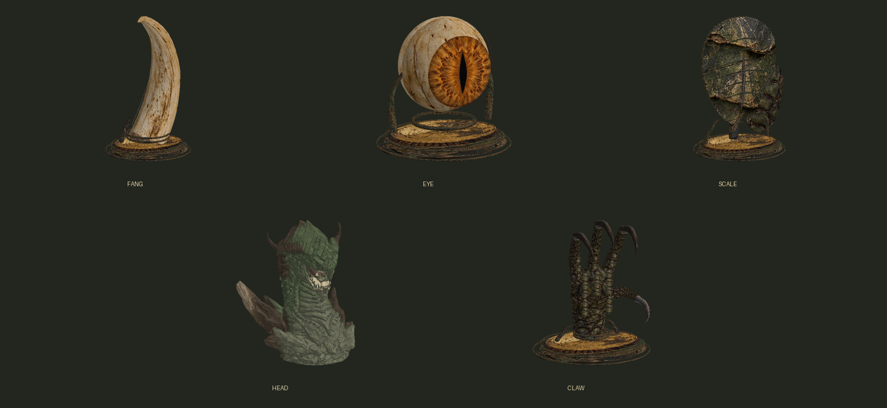

# 飞龙猎获物三维模型

`head` 是 winner_77 的 [Screaming dragon head 3D print](https://skfb.ly/6TrJ8) 的适配版本，采用 [CC BY 4.0](https://creativecommons.org/licenses/by/4.0/)。完整头、颈和原基座均保留，作为展台胸像。原FBX约130万三角形，减至520,000并烘焙原雕刻细节；等比尺寸0.73。1.2.1按二次方案仅修正底色为灰橄榄绿、灰褐喉部和深褐角质，几何、UV、法线和properties逐字节保持。来源、改动与指纹见 `winner77-head-source.json`，署名随运行时模组包提供。

其余 `fang`、`eye`、`scale`、`claw` 是此前的程序化陈列资源，保留供旧存档识别；新击杀只生成龙头宫廷宝物，其余材料使用随身槽，不再新增龙眼。每件提供OBJ、内嵌三张PBR贴图的GLB及实际网格预览。预览不代表CK3最终灯光和相机。



游戏资源位于 `patches/wyvern-capture/mod/gfx/models/artifacts/mm_wyvern_trophies/`。头部使用专用4096颜色／法线／属性DDS，其余旧资源使用共享材质。龙头使用pedestal与tall支撑，原有视觉键名保持。

`winner77-head.npz` 保存优化后的可重建几何和UV，`models.json` 记录所有输出的面数、边界和指纹。头部由已署名的第三方模型改编；其他程序化模型没有复制原游戏或飞龙Mod的几何、纹理或动画。

## 重建

在仓库根目录使用安装有 NumPy 和 Pillow 的 Python 运行：

```powershell
python scripts/build-wyvern-trophy-models.py
```

导出使用已保存的优化几何；如需从原FBX重新减面与烘焙，另安装 `fast-simplification==0.2.0`、`scipy==1.18.1`、`xatlas==0.0.11`，再执行 `python scripts/import-winner77-head.py "原始DragScream.fbx路径"`。该入口只接受已冻结SHA-256的原始文件，不从FBX执行脚本或读取外部链接。

只重烘焙当前底色用`python scripts/import-winner77-head.py "原始DragScream.fbx路径" --albedo-only`；该模式复用现有NPZ/UV，只写diffuse PNG/DDS及颜色来源元数据，不重写NPZ、normal、properties或运行时mesh。离线GLB/预览可以使用既有导出函数单独刷新，无需重跑几何导出入口。

生成器直接写 CK3 所用的 PDX `@@b@` 1.0 数据，Y 向上，三角形面法线与顶点法线的方向已对照原生钻石网格核对。`.asset` 使用原生 `court` shader，显式绑定所有三张材质图。`models.json` 保存顶点数、三角数、边界和运行时网格 SHA-256。

二进制字段参考 [io_pdx_mesh 的独立格式实现](https://github.com/ross-g/io_pdx_mesh/blob/master/pdx_data.py)，本机另外通过该实现的 reader 解读五份输出；本仓库生成器与独立 Node 回归均无需该库。原生资源参考为 `game/common/artifacts/visuals/_visuals.info`、`gfx/models/artifacts/misc/artifact_misc.asset`、`gfx/models/artifacts/trophies/animal/artifact_animal_trophies.asset` 与 `gfx/FX/court_scene.shader`。

这是原生资源与文件结构验证。宫廷插槽的最终比例、摆放朝向、光照和 UI 宝物预览仍需在 CK3 中复测。
